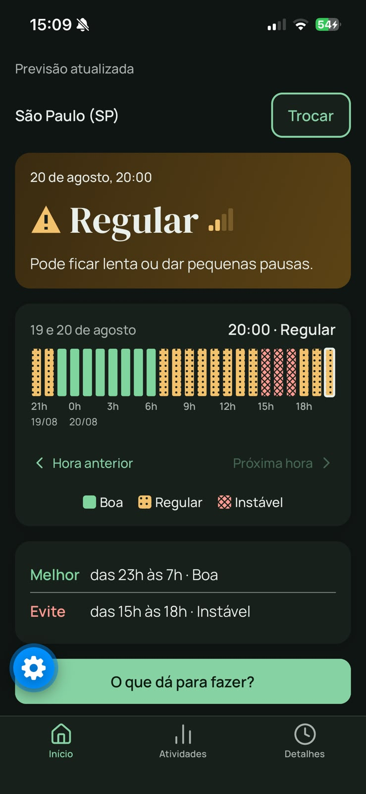
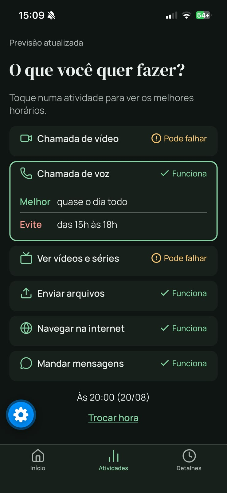
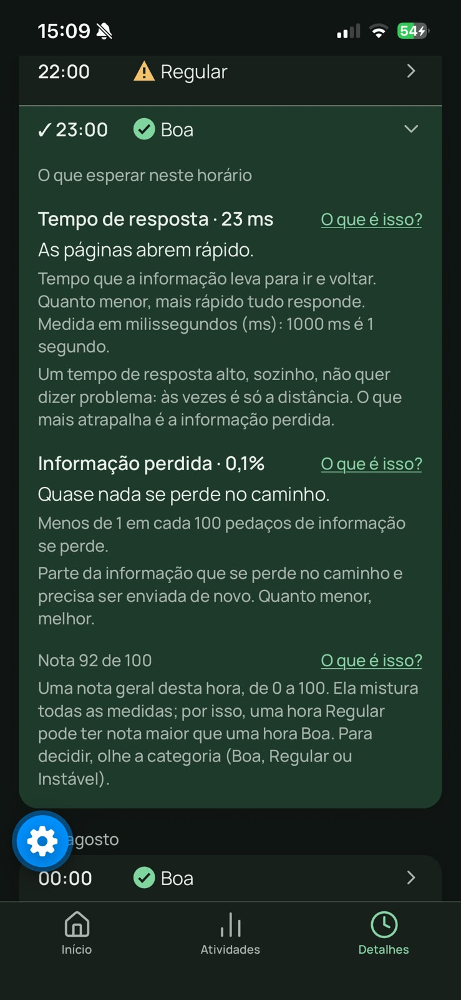
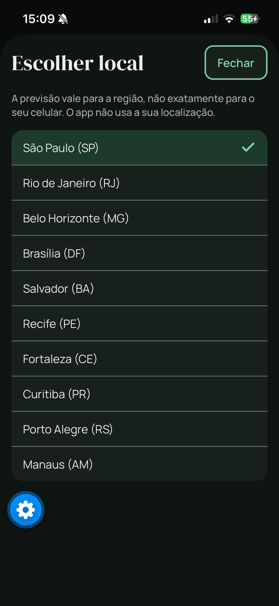

# SinalCerto

[](https://github.com/gabrielmramos-dev/sinalcerto-app/actions/workflows/check.yml)

O SinalCerto mostra, em linguagem simples, como a internet deve estar em cada hora do dia na sua
região: Boa, Regular ou Instável. Ele ajuda quem não entende de redes a escolher a melhor hora para uma
chamada de vídeo, um envio de arquivo ou uma aula on-line, com foco em acessibilidade.


https://github.com/user-attachments/assets/d5759abe-1315-44ab-a10f-66b2dad88ec2


Projeto integrador de Análise e Desenvolvimento de Sistemas (Braz Cubas), disciplina de Programação
para Dispositivos Móveis. React Native + Expo SDK 58 + TypeScript.

## Telas

<p>
  
  
  
  
</p>

Prints do app no iPhone, em modo escuro. O botão azul de engrenagem é do Expo Go, não do app. Mais
prints em `docs/design/` (Detalhes fechado e a tela Sobre).

- **Início:** a região, a hora escolhida (Boa, Regular ou Instável), a faixa das 24 horas e o melhor
  horário do dia.
- **Atividades:** o que dá para fazer na hora escolhida e os melhores horários de cada atividade.
- **Detalhes:** as 24 horas, com o que esperar de cada uma.
- **Escolher local:** a lista de regiões, aberta pelo botão "Trocar".
- **Sobre:** os termos técnicos e a origem dos dados.

## Como instalar o APK (Android)

**Link do build:** https://expo.dev/accounts/gabrieldotech/projects/sinalcerto-app/builds/2f70c8da-5365-4854-8e0c-24f30ff5b2b8

1. Abra o link no navegador do celular Android e baixe o arquivo `.apk`.
2. Toque no arquivo baixado. Se o Android pedir, permita **"Instalar apps desconhecidos"** para o
   navegador e volte.
3. Toque em **Instalar** e depois em **Abrir**. Se o Play Protect avisar, toque em "Instalar mesmo
   assim". O aviso aparece porque o app não está na Play Store.
4. Na primeira abertura, a previsão pode levar até 1 minuto, porque o servidor gratuito da API
   precisa acordar.

Para gerar um APK novo (equipe): `npm install -g eas-cli`, `eas login` e
`eas build -p android --profile preview`. Detalhes na D37.

## Como rodar em desenvolvimento

1. Instale o **Node.js 22.13 ou mais novo** (exigência do Expo SDK 58) e, no celular, o **Expo Go** com suporte ao **SDK 58**.
2. Na pasta do projeto:
   ```bash
   npm install
   npx expo start -c --port 8082
   ```
3. Celular e computador na **mesma rede Wi-Fi**. Leia o QR code com o Expo Go (Android) ou com a
   câmera (iPhone). Se a rede bloquear, por exemplo no Wi-Fi da faculdade, use `npx expo start --tunnel`.

A porta 8082 evita a 8081, que o antivírus do computador da equipe ocupa.

**Usar só a previsão guardada no app** (sem internet, por exemplo na Mostra): crie um arquivo `.env`
com `EXPO_PUBLIC_DATA_SOURCE=mock` e rode `npx expo start -c --port 8082`. Sem essa variável, o app
usa a API real e cai sozinho na previsão guardada quando ela não responde (D27).

| Comando | O que faz |
|---|---|
| `npm run check` | Tipos, lint (com regras de acessibilidade) e testes. Rodar antes de cada entrega; o GitHub Actions roda o mesmo em todo push e PR na `main`. |
| `npm test` | Só os testes (Jest). |
| `npm run coverage` | Testes com o resumo da cobertura. |
| `npm run icons` | Gera o ícone e a tela de abertura a partir de `assets/icon-src/sinal.svg` (D38). |
| `node scripts/save-mock.mjs` | Regrava a previsão guardada com respostas reais da API (cerca de 1.500 chamadas). |
| `LIVE_API=1 npx jest src/data/ApiSource.live` | Testa a conexão com a API no ar (opcional, precisa de rede). |

## Arquitetura

```
Telas (src/app)                Início · Atividades · Detalhes · Escolher local · Sobre
   │
   ▼
ForecastSource (src/data)      contrato único das telas: previsão, 24 horas, regiões, atividades
   │
   ├─▶ ApiSource  ──▶ Internet Quality API 0.2.0 (https://internet-quality-api.onrender.com)
   │
   └─▶ MockSource ──▶ previsão guardada no app (respostas reais da API, src/data/mock)
        (a FallbackSource usa a API e, se ela não responder, a MockSource)
```

| Pasta | O que tem |
|---|---|
| `src/app` | As telas e a navegação (Expo Router): abas Início, Atividades e Detalhes; Escolher local e Sobre. |
| `src/components` | Peças das telas: faixa do dia, cartões, linhas, botões. |
| `src/data` | Fontes de dados, a previsão guardada, horários e regiões. |
| `src/lib` | Regras puras, com teste: melhor horário e frases "Melhor/Evite". |
| `src/hooks` | Carregamento, consultas de atividades e a hora escolhida no app. |
| `src/i18n/glossary.ts` | Todos os textos do app, num lugar só. |
| `src/theme` | Cores (claro e escuro), fontes, espaços e o teste de contraste. |
| `src/__tests__` | Testes das telas, de vocabulário e de acessibilidade. |
| `docs` | Decisões, requisitos, design, registro de uso de IA, roteiro da Mostra. |

## Requisitos

| Requisito | O que pede | Estado | Onde foi atendido |
|---|---|---|---|
| RQ01 | Condição prevista em categorias compreensíveis | Feito | Início: cartão com Boa, Regular ou Instável da hora escolhida, com ícone, cor e uma frase. |
| RQ02 | Qualidade prevista para períodos futuros | Feito | Início (faixa das 24 horas) e Detalhes (hora a hora). |
| RQ03 | Atividades adequadas, em linguagem simples | Parcial (6 de 7) | Atividades: chamada de vídeo, chamada de voz, vídeos e séries, envio de arquivos, navegação e mensagens. **Jogos online ficou de fora: a API 0.2.0 não tem essa atividade.** |
| RQ04 | Escolher horário ou período do dia | Feito | Faixa do dia no Início (toque, "Hora anterior/Próxima hora" e leitor de tela) e lista de Detalhes. A hora vale no app inteiro. |
| RNF01 | ABNT NBR 17060 e WCAG 2.2 AA | Parcial | Critérios aplicados e testados nas telas. Falta o teste com TalkBack. |
| RNF02 | Uso completo com TalkBack e VoiceOver | Parcial | VoiceOver testado no iPhone em todas as telas; todo controle tem nome, função e estado. **TalkBack pendente** (teste no Android). |
| RNF03 | Nada só por cor ou ícone | Feito | Categoria sempre em texto + forma + cor; barras com padrão (liso, pontilhado, quadriculado); seleção com ✓. |
| RNF04 | Contraste 4,5:1 (texto) e 3:1 (gráficos) | Feito | Todos os pares de cores testados, nos modos claro e escuro (`src/theme/contrast.test.ts`). |
| RNF05 | Fonte do sistema, sem cortes | Feito no iPhone | Texto no máximo testado em todas as telas. Os rótulos de hora dentro da faixa não crescem; a hora e a categoria aparecem em texto que cresce. Android pendente. |
| RNF06 | Sem gestos complexos | Feito | Só toques simples; a faixa também tem botões de hora. |
| RNF07 | Linguagem simples, termos explicados | Feito | "O que esperar neste horário" em Detalhes, com "O que é isso?"; termos técnicos só na tela Sobre. |
| RNF08 | Ordem lógica, foco e anúncios | Parcial | VoiceOver: anúncios da previsão e da hora escolhida, foco no "Fechar" do modal e na faixa. TalkBack pendente. |
| RNF09 | Área de toque de 48 × 48 dp | Feito | Botões, linhas e links com 48 dp (verificado em testes). |

A situação detalhada de cada requisito, com o que foi testado e quando, está em [STATUS.md](STATUS.md).

## Acessibilidade

**Testado no iPhone, a cada etapa:**
- VoiceOver em todas as telas: ordem de leitura, cabeçalhos, estados ("selecionado", "expandido"),
  faixa do dia ajustável e foco levado ao "Fechar" e à faixa;
- texto do sistema no tamanho máximo, sem cortes;
- modo claro e modo escuro.

**Testado automaticamente:**
- contraste de todos os pares de cores nos dois modos;
- área de toque de 48 dp;
- vocabulário: nenhum termo técnico ("API", "modelo", "Redes"…) fora da tela Sobre.

**Falta:** o teste com TalkBack e com texto grande no Android. O APK está pronto, e o teste depende do
celular da equipe.

## Design

As decisões de design têm base em pesquisa, resumida em
[docs/fundamentacao-design.md](docs/fundamentacao-design.md): Cleveland e McGill, Waldner et al.,
Kay et al., Nielsen Norman Group, Nielsen, WCAG e NBR 17060. Por exemplo, a faixa de barras substituiu
o relógio de 24 horas porque gráficos lineares são lidos com mais precisão (D33).

O desenho das telas segue o wireframe aprovado: [docs/design/wireframe-v2.md](docs/design/wireframe-v2.md).

A revisão de design comparou o app com a linha de base inicial (`design-baseline.json`): a nota passou
de **B para A**, sem nenhum problema de alta severidade em aberto. Os pontos médios que sobraram estão
no STATUS.

## Testes

```bash
npm test            # 243 testes passando, 2 pulados (os de API ao vivo)
npm run coverage    # testes + resumo da cobertura
```

| Cobertura (`src`, sem os testes) | Resultado |
|---|---|
| Instruções (statements) | 95,39% (725 de 760) |
| Ramos (branches) | 87,84% (441 de 502) |
| Funções | 93,72% (254 de 271) |
| Linhas | 96,37% (612 de 635) |

A cobertura é só uma medida, não uma meta: o que mais importa são os testes de acessibilidade e de
comportamento das telas.

## Decisões, uso de IA e equipe

- **Decisões de projeto, com o motivo de cada uma:** [docs/DECISOES.md](docs/DECISOES.md).
- **Registro do uso de IA:** [docs/prompts-ia.md](docs/prompts-ia.md), com o que foi pedido, o que a IA fez e os erros dela.
- **Situação atual:** [STATUS.md](STATUS.md). **Roteiro da Mostra:** [docs/MOSTRA.md](docs/MOSTRA.md).

| Integrante | Papel |
|---|---|
| Gabriel Macena Ramos | Product Owner (PO) |
| Carlos Henryque de Melo Alcantara | Scrum Master (SM) |
| Gabriel Martins Reis | Desenvolvedor (Time de Desenvolvimento) |
| Pedro Henrique Maia Jordão | Desenvolvedor (Time de Desenvolvimento) |
| Leonardo Vitale dos Santos | Desenvolvedor (Time de Desenvolvimento) |

## Limitações

- **Datas:** os dados da API cobrem só um dia, de 19/08/2026 21h a 20/08/2026 20h (horário de
  Brasília). Por isso o app mostra sempre a data real e nunca chama a previsão de "agora".
- **Região:** a previsão vale para a região escolhida (um ponto de medição numa capital), não
  exatamente para o seu celular.
- **Medição:** o app não mede a sua conexão. Ele mostra uma estimativa calculada a partir de como a
  internet se comportou antes, e ela pode errar.
- **Jogos online:** a atividade não aparece porque a API não tem essa opção.
- **Android:** o app ainda não foi testado num aparelho Android, nem com o TalkBack.
